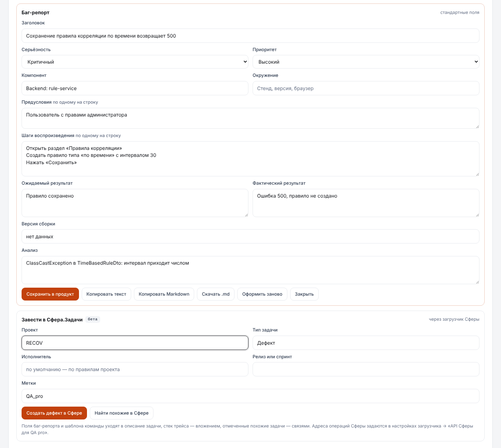
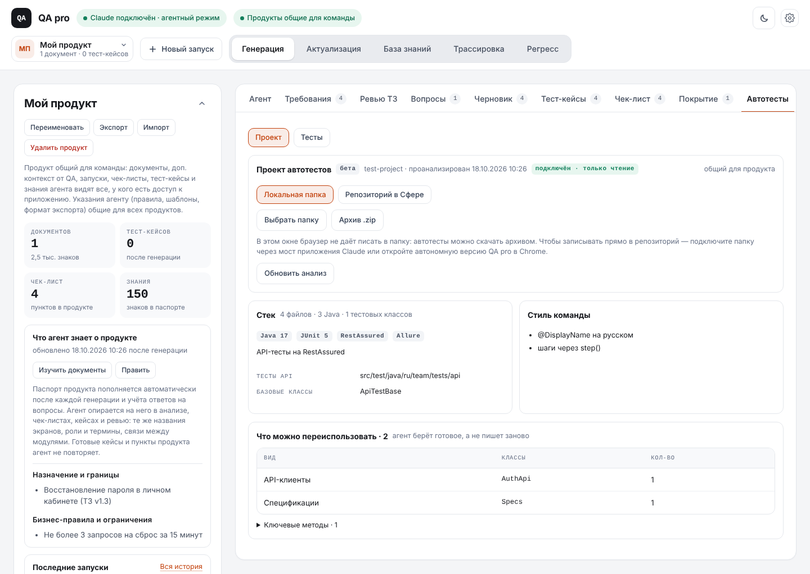
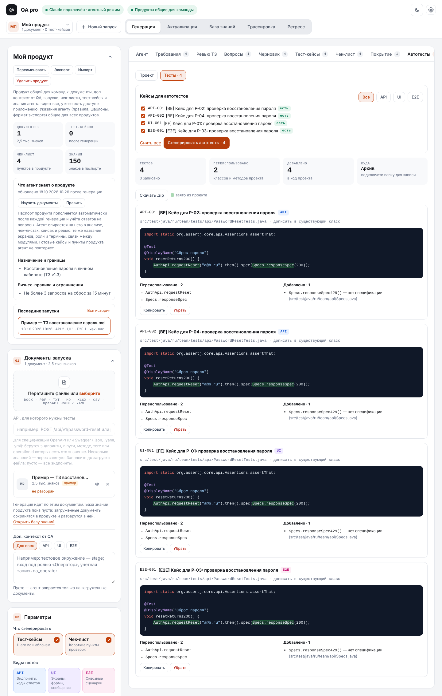
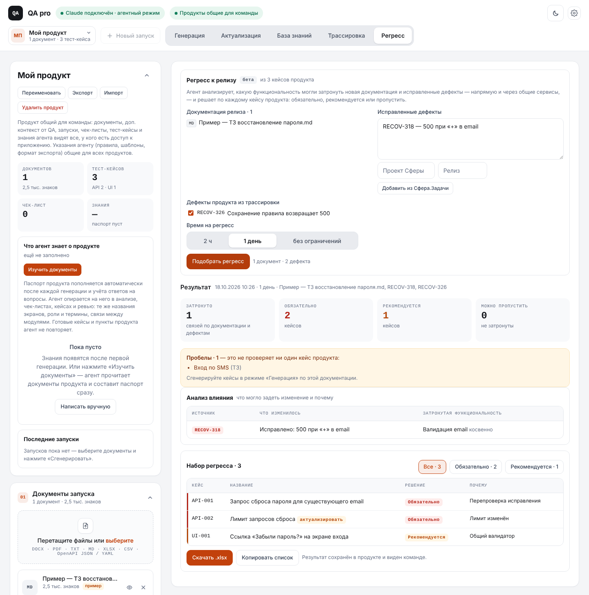
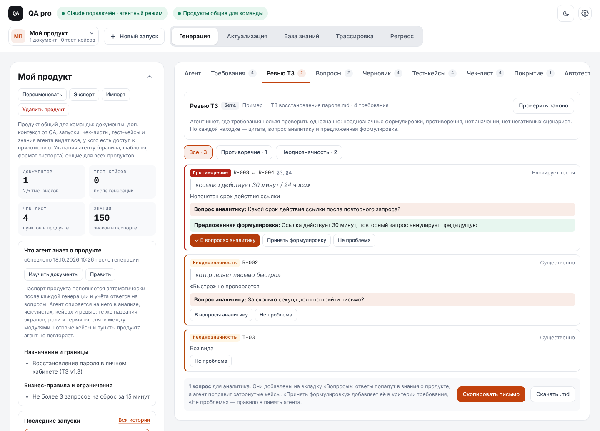
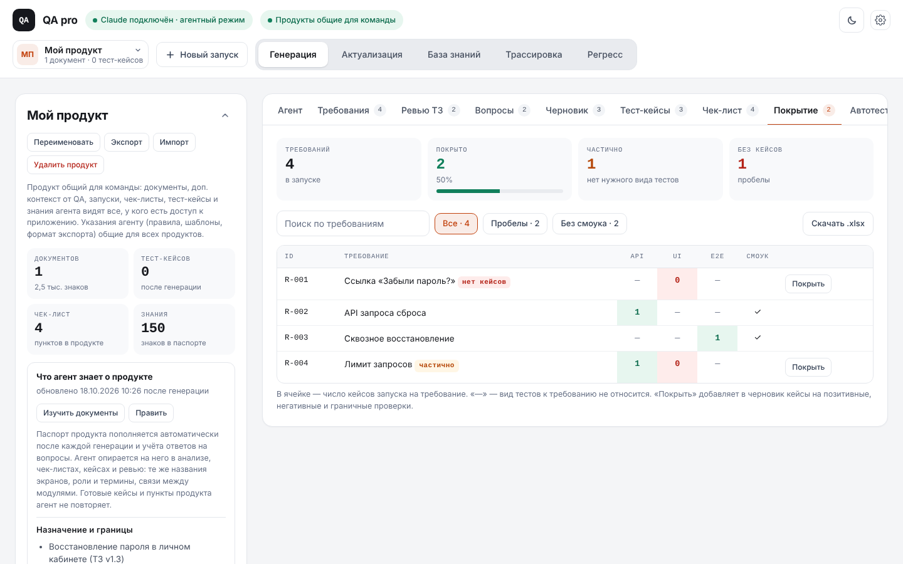

# QA pro: бета-функции (ветка `beta-feature`)

Ветка собирает все пять предложений по доработке QA pro. Они помечены в интерфейсе меткой «бета» и обкатываются отдельно от основного приложения. Исходное описание с макетами — [proposals/index.html](proposals/index.html), скрины ниже сняты с работающего приложения (ответы модели — из тестовой имитации).

| # | Функция | Где в интерфейсе | Что нужно для работы |
|---|---|---|---|
| 1 | Баг-репорт по трассировке и дефект в Сфера.Задачи | режим «Трассировка» | для Сферы — загрузчик 1.7 и операции `tasks.*` в его настройках |
| 2 | Автотесты в стиле проекта, запись в репозиторий | вкладка «Автотесты» | проект автотестов: локальная папка, мост или репозиторий Сферы |
| 3 | Регресс к релизу | режим «Регресс» | кейсы в продукте; для дефектов из Сферы — операция `tasks.search` |
| 5 | Ревью ТЗ | вкладка «Ревью ТЗ» | запуск с выделенными требованиями |
| 6 | Матрица покрытия | вкладка «Покрытие» | запуск с требованиями и кейсами |

---

## 1. Баг-репорт и Сфера.Задачи



- После трассировки **Оформить дефект**: карточка по шаблону команды (настройки → «Шаблон дефекта»), связанные кейсы продукта, поиск дублей среди сохранённых дефектов.
- **Завести в Сфера.Задачи**: проект, тип, исполнитель, релиз, метки. Описание задачи — HTML из полей баг-репорта и шаблона, стек трейса — вложение, отмеченные похожие задачи — связи.
- **Найти похожие в Сфере** — поиск задач проекта Сферы перед созданием. Если похожий дефект исправлен, лучше переоткрыть его.
- Номер и статус задачи хранятся в дефекте продукта. **Обновить статусы из Сферы** — в списке «Дефекты продукта».

## 2. Автотесты




**Подключение проекта** (вкладка «Автотесты» → «Проект»):
- **Локальная папка.** В Chrome (автономная версия) — «Выбрать папку репозитория»: браузер спрашивает разрешение на изменение, после этого QA pro записывает тесты прямо в рабочую копию. Если окно не даёт доступ на запись (артефакт на claude.ai), — «Только чтение» или архив .zip.
- **Папка через мост** (приложение Claude): полный путь к репозиторию. Мост `qa-pro-bridge` 1.4 читает и пишет файлы только внутри этой папки (`project_list`, `project_read`, `project_write`), не выходит за неё ни по `..`, ни по символическим ссылкам, пишет только исходники и конфиги (`.java`, `.kt`, `.properties`, `.json`, `.yaml`, `.xml`, `.md`, `.feature`).
- **Репозиторий в Сфере.** Загрузчик Сферы читает репозиторий под входом пользователя (`repo.tree`, `repo.file`) — он стал импортером. Запись — ветка, коммит и запрос на слияние (`repo.branch`, `repo.commit`, `repo.mr`).

**Анализ проекта.** QA pro сам разбирает файлы: стек по сборке (Gradle/Maven, JUnit, RestAssured, Selenide, Allure, Owner…), каталог классов с публичными методами по видам (клиенты, спецификации, модели, Page Object, хелперы, данные), тестовые классы, типичные тесты. Модель по этому составляет профиль: стиль команды, соглашения, что переиспользовать, чего нет. Профиль хранится в продукте и общий для команды.

**Генерация.** Для каждого выбранного кейса модель получает профиль, ближайшие классы каталога, похожие тесты и список тестовых классов. Тест дописывается в существующий класс по фиче или создаётся новый файл. Имена «переиспользовано», которых нет в каталоге, отбрасываются. Код подсвечен: зелёным — взятое из проекта.

**Запись.** Метод вставляется перед последней скобкой класса, недостающие import — после существующих. Добавленное агентом в код проекта (например, новая спецификация) дописывается в свой файл; если файла нет — это попадает в замечания. Коммит и пуш для локальной папки делает тестировщик. Без доступа на запись — **Скачать .zip** с готовыми файлами.

## 3. Регресс к релизу



- **Документация релиза** — документы, отмеченные в «Документах запуска»: новая функциональность и новые версии ТЗ.
- **Исправленные дефекты** — строками (`RECOV-311 — описание`), галочками из дефектов продукта (с местом сбоя из трассировки) или **Из Сфера.Задачи** по проекту и релизу.
- **Анализ влияния** — что изменилось и какую функциональность могло задеть: напрямую и косвенно, через общие сервисы, валидаторы, счётчики из паспорта продукта. Связи без опоры на знания продукта помечены «гипотеза».
- **Решение по кейсам** продукта: «обязательно», «рекомендуется», остальные пропускаются. Устаревшие кейсы — с пометкой «актуализировать». Пробелы — то, что не проверяет ни один кейс.
- Бюджет времени: 2 часа, день, без ограничений. Результат хранится в продукте; **Скачать .xlsx**, **Копировать список**.

## 5. Ревью ТЗ



- Виды находок: противоречие, нет значения, неоднозначность, нет негатива, нетестируемо; важность: блокирует тесты, существенно, мелочь.
- **В вопросы аналитику** — вопрос попадает на вкладку «Вопросы» (ответы учитываются как обычно). **Принять формулировку** — добавляет её в критерии требования. **Не проблема** — правило в память агента для ревью.
- **Скопировать письмо** с выбранными вопросами, **Скачать .md** с находками.

## 6. Матрица покрытия



Требования запуска × API, UI, E2E и смоук. «—» — вид тестов к требованию не относится. Состояния: покрыто, частично, нет кейсов (уже покрытое кейсами продукта считается покрытым). Фильтры «Пробелы» и «Без смоука», поиск, **Покрыть** — добавляет кейсы в черновик, **Скачать .xlsx**.

---

## Настройка операций Сферы

Адреса API Сфера.Задачи и репозиториев не зашиты в загрузчик: у инсталляций Сферы они разные и в проекте их ещё не изучали. Их задают в настройках загрузчика → **API Сферы для QA pro** — JSON вида:

```json
{
  "tasks.create": {
    "method": "POST",
    "path": "/app/tasks/api/v1/...{project}...",
    "body": { "name": "{title}", "description": "{description}", "labels": "{labels}" },
    "map": { "key": "number", "url": "link" }
  },
  "tasks.search": {
    "path": "/app/tasks/api/v1/...",
    "query": { "project": "{project}", "q": "{text}", "release": "{release}" },
    "pick": "content",
    "map": { "key": "number", "title": "name", "status": "status.name" }
  }
}
```

- `{имя}` внутри строки подставляется текстом (в `path` — с URL-кодированием); значение, равное `"{имя}"` целиком, подставляется с типом (массив, объект, число). Пустые параметры `query` не отправляются.
- `pick` — путь к результату в ответе, `map` — поля результата (для массива — для каждого элемента).
- Как заполнить: в Сфере DevTools → Network, выполнить действие вручную (создать дефект, найти задачи, открыть файл репозитория), перенести адрес, метод и тело.

| Операция | Аргументы от QA pro | Ожидаемый результат |
|---|---|---|
| `tasks.search` | project, text, type, status, release, limit | `[{key, title, status, url}]` |
| `tasks.create` | project, type, title, description (HTML), descriptionText, severity, severityRu, priority, priorityRu, assignee, release, labels, relatedCases, component, environment | `{key, url}` |
| `tasks.get` | key | `{key, title, status, url}` |
| `tasks.attach` | key, filename, content | — |
| `tasks.link` | key, target, kind | — |
| `repo.tree` | project, repo, branch | `[{path, type}]` |
| `repo.file` | project, repo, branch, path | `{content}` или строка |
| `repo.branch` | project, repo, from, name | — |
| `repo.commit` | project, repo, branch, message, files `[{path, content}]` | `{id}` |
| `repo.mr` | project, repo, source, target, title, description | `{url}` |

Путь вызова: QA pro в Chrome → загрузчик (`SFERA_CALL`); QA pro в приложении Claude → мост (`sfera_call`) → загрузчик по WebSocket (`call` / `call_result`). Пока операция не описана, QA pro показывает, где её настроить.

## Что не проверено на живом окружении

- Операции Сфера.Задачи и репозиториев Сферы — адреса нужно снять из DevTools (HAR) и проверить на настоящей Сфере.
- Запись в локальную папку через доступ браузера к папке — в артефакте на claude.ai браузер может не дать доступ на запись; тогда — мост или автономная версия.
- Инструменты моста `sfera_call`, `project_*` в приложении Claude: странице их нужно объявить при публикации из локальной сессии Claude (как раньше для `sfera_*`).

## Тесты

`tests/test_beta.py` (функции в интерфейсе), `tests/test_defect.py` (баг-репорт), `tests/uploader/test_bridge_beta.py` (новые инструменты моста, защита путей), `tests/uploader/test_sfera_ops.py` (операции загрузчика: подстановки, pick/map, ошибки).
